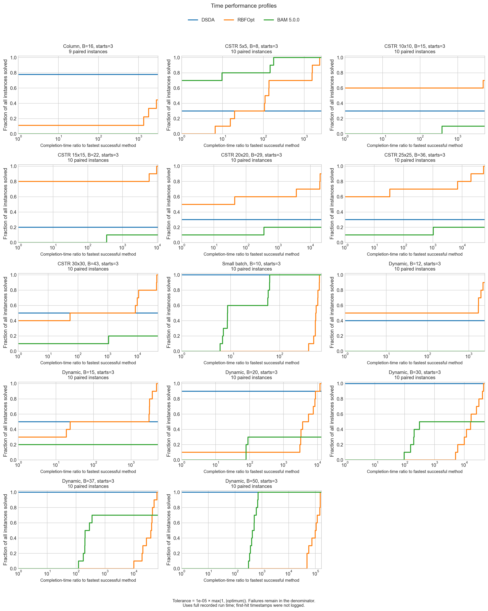
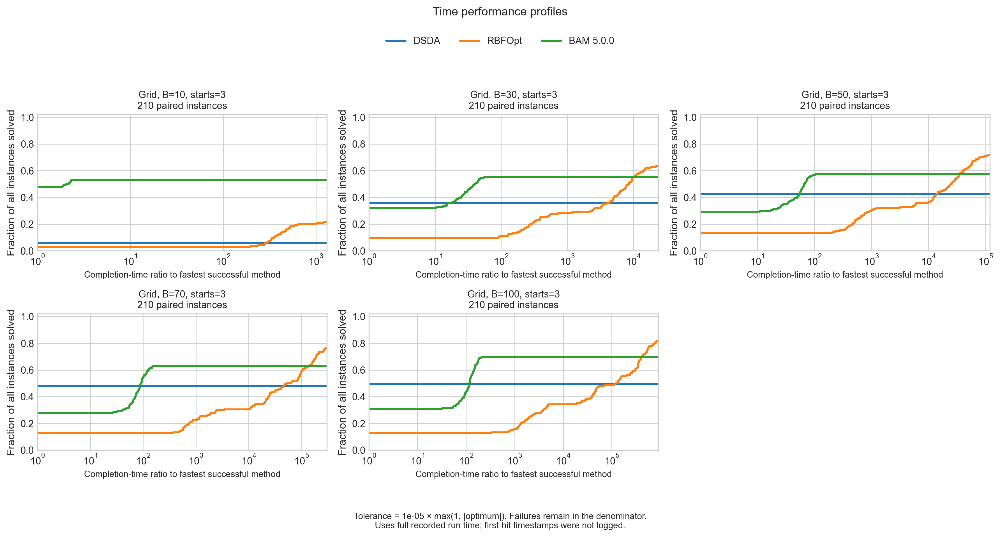

# Dantzig time profiles with BAM 5.0.0

These two figures update the three-method comparison to **DSDA, RBFOpt, and
BAM 5.0.0**. They are ready to replace the earlier time-profile images in the
slides. DSDA and RBFOpt retain their original Dantzig results; every BAM row
comes from the September 16 rerun. The original BAM 4.1.1 results and figures
remain in their dated bundles.

## Process cases



The figure contains 417 runs across 14 configurations: nine paired seeds for
Column and ten for every other configuration. Column, CSTR, and Small Batch
have the same terminal objectives as in BAM 4.1.1. Dynamic success counts
change from 0/10 to 2/10 at budget 15, from 10/10 to 5/10 at budget 30, and from
10/10 to 7/10 at budget 37. Both BAM versions succeed in 10/10 runs at budget
50. Process runtimes do not show the consistent large reduction seen on the
grid benchmarks.

Slide highlight: **Unchanged Column/CSTR/Small Batch results; mixed Dynamic
success rates, with 10/10 successes at budget 50.**

## Grid benchmarks



The figure contains 3,150 runs: 21 grids, ten seeds, five budgets, and three
methods. Each panel has 210 paired instances. BAM 5.0.0 takes substantially
less time than 4.1.1, but its success fraction is not uniformly higher.

| Evaluation budget | BAM 4.1.1 solved | BAM 5.0.0 solved | BAM 4.1.1 median time (s) | BAM 5.0.0 median time (s) |
| --- | --- | --- | --- | --- |
| 10 | 111/210 (52.9%) | 111/210 (52.9%) | 0.018700 | 0.005970 |
| 30 | 117/210 (55.7%) | 116/210 (55.2%) | 0.679875 | 0.102457 |
| 50 | 124/210 (59.0%) | 121/210 (57.6%) | 1.360839 | 0.191582 |
| 70 | 129/210 (61.4%) | 132/210 (62.9%) | 1.908436 | 0.277468 |
| 100 | 166/210 (79.0%) | 147/210 (70.0%) | 3.260301 | 0.410763 |

Time medians include both successful and unsuccessful runs. The approximately
3–8× speedup compares the old and new medians within each budget, rather than
the time to reach a common target. The old-version numbers provide context;
the two figures contain only the new BAM version.

Slide highlight: **Lower BAM runtime, with a speed–success trade-off at larger
budgets (70.0% solved at budget 100).**

## Reading the figures

A run succeeds when
`abs(best_value - optimum) <= 1e-5 * max(1, abs(optimum))`.
For each problem/seed/starting-design/budget instance, the horizontal axis is
the successful run's full recorded wall time divided by the fastest successful
time among **DSDA, RBFOpt, and BAM 5.0.0**. Ratios were recalculated for this
three-method set; they were not copied from the four-method version review.
The vertical axis is the fraction of all paired instances, including failures.
The final plateau is the solved fraction; a curve further left reaches that
fraction at a smaller relative completion time.

These are **completed-run profiles**, not first-hit-time profiles: incumbent
timestamps were not logged. Objectives are precomputed lookups, so the timings
mainly reflect optimizer overhead rather than repeatedly solving the process
models. Both Dantzig runs used CPU 0 and one numerical-library thread, but
external server load was not measured. Repeated budgets and grid sizes are
shown separately, rather than treated as independent replications.

## Inputs and reproducibility

- DSDA/RBFOpt: [original Dantzig archive](../archives/dantzig_20260910_170759_slN8tv.zip).
- BAM: [BAM-only rerun archive](../../dantzig_bam_20260916_231228_FNzbAA.zip),
  Python package 5.0.0 and native solver 2026.9.10.
- All methods use the same three starting points per instance, included in the
  evaluation budget. The BAM rerun contains 1,050 grid and 139 process runs,
  with matching original run keys and initial-design audit records.

From the repository root, with the project analysis dependencies installed:

```sh
MPLBACKEND=Agg python results/bam_20260916/generate_profiles.py
```

The command reads both existing ZIPs, checks the source CSV hashes against the
archived comparison audit, validates the process manifests, and checks BAM
run keys, targets, process initial designs, case parameters, and shared source
hashes. It keeps the original DSDA/RBFOpt observations and selects the complete
new BAM dataset. It invokes no optimizers and requires no BAM license. The
two PNGs are saved at 250 dpi using the existing plotting code and colors.

Each figure has supporting data and provenance:

| Artifact | Grid | Process cases |
| --- | --- | --- |
| Per-run success, costs, and ratios | [CSV](grid/time_profile_runs.csv) | [CSV](case/time_profile_runs.csv) |
| Success counts and time/work summaries | [CSV](grid/time_work_summary.csv) | [CSV](case/time_work_summary.csv) |
| Archive, data, and analysis checksums | [Manifest](grid/timing_analysis.manifest.json) | [Manifest](case/timing_analysis.manifest.json) |

The original bundles remain available for [BAM 4.1.1 grid profiles](../grid_benchmarks/dantzig_20260910/README.md)
and [BAM 4.1.1 process profiles](../case_studies/dantzig_20260910/README.md).
