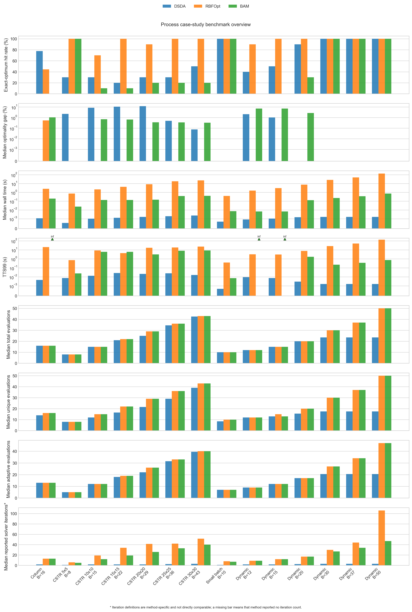
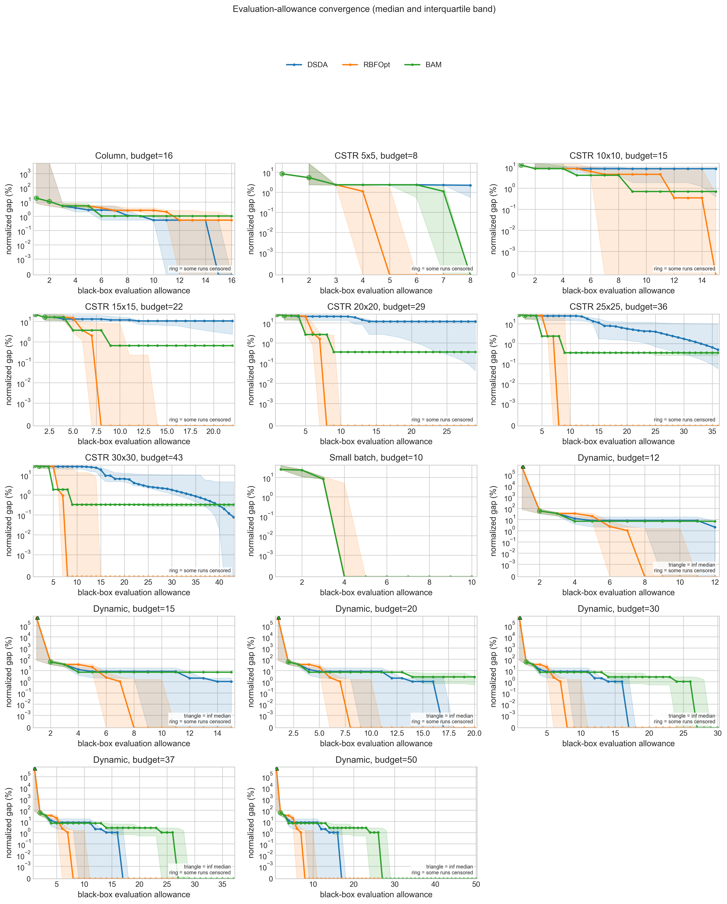
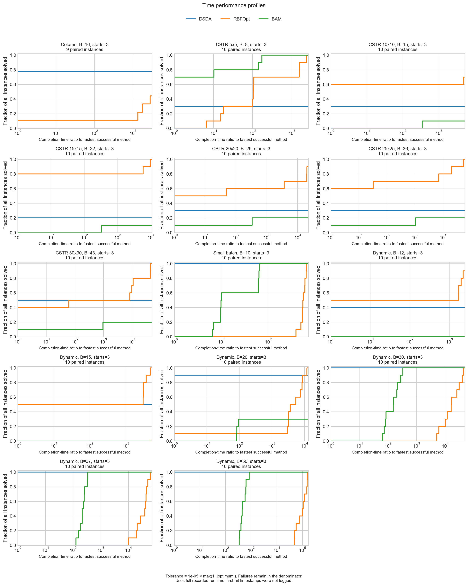
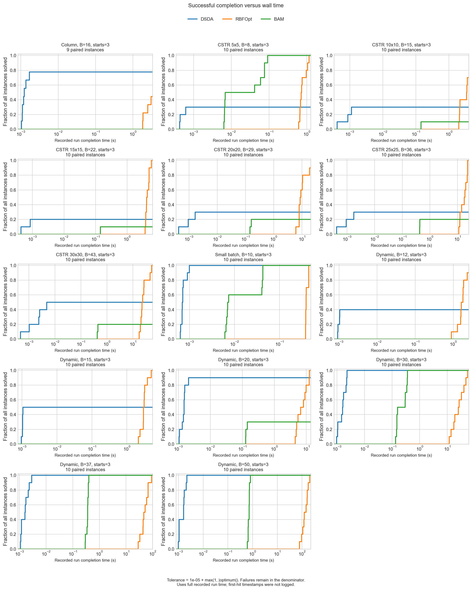
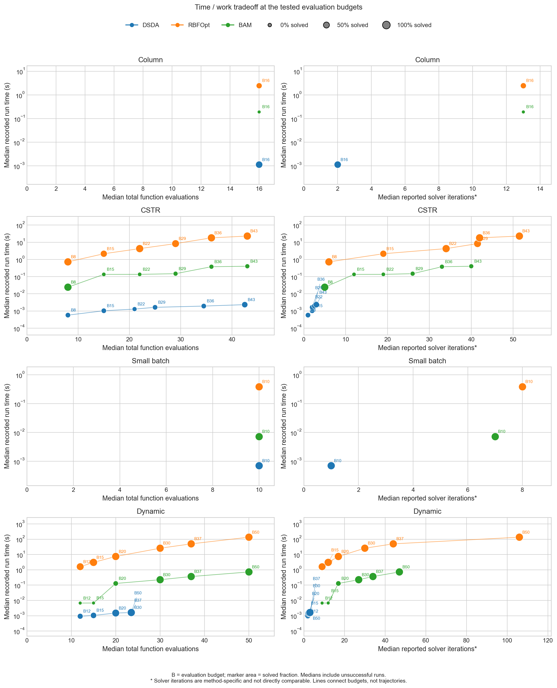

# Dantzig process case-study results

This bundle provides the completed BAM, DSDA, and RBFOpt comparison for
[Issue #18](https://github.com/SECQUOIA/RBFopt_Test/issues/18). It contains 417
method runs from Dantzig, completed on September 13, 2026, and static figures
regenerated from the audited CSV with `case_study_analysis.py`.

| Issue requirement | Evidence |
|---|---|
| Recreate process case-study figures | Overview and evaluation convergence figures for Column, CSTR, Small batch, and Dynamic |
| Compare BAM, DSDA, and RBFOpt | All three methods appear in every configuration and figure |
| Use reproducible audited outputs | Source CSV, completed manifest, summary tables, and regeneration command are included |
| Show hit rate, time, and evaluation/iteration measures | Overview shows exact-optimum hit rate, gap, wall time, TTS99, total/unique/adaptive evaluations, and method-specific iterations |
| Use comparable progress measures | Convergence is indexed by black-box evaluation; solver iterations are explicitly labeled as method-specific |

The issue makes trajectory animations conditional. The deliverables here are
static plots backed by logged incumbent values at each evaluation.

The overview summarizes all 14 case/budget configurations:



The convergence figure shows median optimality gaps and interquartile ranges
across seeds, using the full configuration denominator at every evaluation:



Time profiles and work tradeoffs

The follow-up to [PR #23](https://github.com/SECQUOIA/RBFopt_Test/pull/23#issuecomment-5688291659)
adds the following figures for all 14 case/budget configurations:







The time profiles use a terminal success tolerance of
`1e-5 * max(1, abs(optimum))`. A successful run's cost is its recorded full wall
time; an unsuccessful run's cost is infinity. The performance profile divides
this cost by the fastest successful method on the same case/seed/initialization/
budget. All-failed instances retain infinite ratios. Each panel's denominator
includes every paired seed (nine for Column, ten otherwise), including failures.
The second figure uses the same costs on a seconds axis. Each configuration is
kept separate; neither figure pools the repeated Dynamic budgets or CSTR sizes.

The archive contains no incumbent timestamps, so these are **completed-run time
profiles**, not measured time-to-first-optimum curves. A solver can continue
after finding the target; recorded total time is not prorated by evaluations.
Exact first-hit times require a rerun with elapsed evaluation timestamps.

Tradeoff points show median total evaluations or median reported solver
iterations against median runtime, with marker area indicating the solved
fraction. All seeds, including unsuccessful runs, enter each time/evaluation
median. Solver iterations remain method-specific. Lines connect configurations,
not within-run trajectories. For CSTR, both grid size and budget increase
together according to the protocol table below; this is not a fixed-size budget
sweep. The [grid benchmark bundle](../../grid_benchmarks/dantzig_20260910/README.md)
documents the same definitions and provides the grid comparisons.

Per-run costs and ratios are in [time_profile_runs.csv](analysis/time_profile_runs.csv),
and plotted medians and success fractions in [time_work_summary.csv](analysis/time_work_summary.csv).
The [timing analysis manifest](analysis/timing_analysis.manifest.json) records
input/source checksums, tolerance, and plotting-library versions.

Source data and scope

- [Audited method runs](process_case_studies.csv): 417 rows, with 139 rows per method.
- [Original completed manifest](process_case_studies.manifest.json): protocol,
  software versions, source/data hashes, initial-design hashes, planned and
  completed run keys, output checksum, and execution history.
- [Configuration summaries](analysis/case_study_summary.csv): 42 rows.
- [Evaluation convergence summaries](analysis/evaluation_convergence_summary.csv).

The input CSV and manifest were copied without changes from the
[original Dantzig archive](../../archives/dantzig_20260910_170759_slN8tv.zip).
The archive also retains the complete `python-packages.txt` dependency snapshot.
Core solver and numerical-library versions are recorded in the manifest;
the original analysis used pandas 3.0.5 and Matplotlib 3.11.1.
Paths inside the manifest describe the
original run location. The CSV SHA-256 is
`97c554d05cc7624203578bcc4496c77f6f3a04f7b25cf5cb8892611628d1bba6`.
The source commit recorded for the experiment is
`eeb560059c7001ad82c13b9249168531af073f95`.

| Case | Seeds | Evaluation budgets | Runs across three methods |
|---|---|---|---:|
| Column | 1–9 | 16 | 27 |
| CSTR | 0–9 | Grid sizes 5, 10, 15, 20, 25, 30; budgets 8, 15, 22, 29, 36, 43 | 180 |
| Small batch | 0–9 | 10 | 30 |
| Dynamic | 0–9 | 12, 15, 20, 30, 37, 50 | 180 |

All methods receive the same three-point LHC design for each configuration.
Its evaluations count toward the budget. Column excludes seed 0 under the
existing protocol because it has no feasible DSDA initial point. CSTR budgets
scale as `ceil(10 * grid_size / 7)`.

To regenerate from the repository root in an environment with the project's
Python dependencies installed:

```bash
MPLBACKEND=Agg python case_study_analysis.py \
  --results-csv results/case_studies/dantzig_20260910/process_case_studies.csv \
  --output-dir results/case_studies/dantzig_20260910/analysis
```

This command validates the paired manifest, CSV checksum, row count, and audit
fields before producing the two tables and two PNGs. Analysis uses the saved
results and does not invoke the optimizers or external solver executables.
PNG appearance can vary with plotting-library and font versions.

Regenerate the three timing figures and their source tables with:

```bash
MPLBACKEND=Agg python timing_analysis.py \
  --dataset case \
  --results-csv results/case_studies/dantzig_20260910/process_case_studies.csv \
  --output-dir results/case_studies/dantzig_20260910/analysis
```

The optimality-gap plots retain exact zeros using a linear region below
`0.001%` and a logarithmic scale above it. Their axes start at zero, eliminating
negative automatic margins. Negative gap inputs raise an error rather than
being hidden or converted to absolute values; signed audit tables are preserved.

Observed results

- Column at budget 16: DSDA reaches the optimum in 7/9 runs, RBFOpt in 4/9,
  and BAM in 0/9.
- CSTR across the six grid sizes: RBFOpt reaches the optimum in 56/60 runs,
  DSDA in 19/60, and BAM in 18/60. BAM's median gaps for grid sizes 10–30
  remain below 0.7% despite lower exact-optimum hit rates.
- Dynamic: RBFOpt reaches 10/10 hits from budget 15; all three methods reach
  10/10 from budget 30.
- Small batch at budget 10: all methods reach 10/10 hits.

These are descriptive comparisons. CSTR sizes and Dynamic budgets reuse seeds;
pooling all rows does not create independent replications of one problem.

Interpretation and validation

Objectives are retrieved from precomputed process-case data. Wall time includes
the initial evaluations and optimizer execution, including RBFOpt construction,
after loading data and creating the shared initial design. The measured time
therefore reflects the lookup objective and optimizer overhead in this run.
It does not measure repeatedly solving the underlying process models. The
original run used verbose output, one logical CPU, and one numerical-library
thread.

Iteration definitions differ between methods; the overview labels them
accordingly. Evaluation counts and evaluation-indexed convergence provide the
common work measure. Total evaluations count repeated calls, while unique
evaluations count distinct points. Early-terminated trajectories carry their
last incumbent through the configured budget. Leading non-finite incumbents
remain censored in convergence summaries. No terminal-only trace fallback was
needed for these 417 runs.

The objective wrappers also differ in their handling of infeasible points:
Column and Dynamic use a finite penalty for DSDA/RBFOpt, CSTR and Small batch
use infinity, and BAM receives NaN. The results compare these recorded wrapper
settings. Initial finite incumbent histories agree across methods after
normalizing infeasible representations.

TTS99 is an estimate from the empirical exact-optimum hit rate and median run
time, assuming independent restarts. Zero observed hits produce infinite TTS99.
The estimate is based on only 9 or 10 seeds per configuration and is not an
observed time to the first optimum or a calibrated probability guarantee.

Validation confirmed complete planned-run coverage, unique run identifiers,
evaluation-budget accounting, finite terminal values, consistent incumbent
histories, and the CSV checksum. The recorded 22 source-file hashes were checked
against the original experiment revision, and all eight case-data hashes match
the inputs. This follow-up changes analysis/plotting code, so the experiment's
original source hashes and the new timing analysis hashes describe different
revisions. Both regenerated original summary tables were
checked numerically against the original Dantzig analysis outputs. Both figures
were visually inspected.

The original log contains 32 RBFOpt `invalid value encountered in divide`
warnings during the process stage. All 417 runs completed with finite final
objective values. BAM status 35 records termination at the function-call limit.
