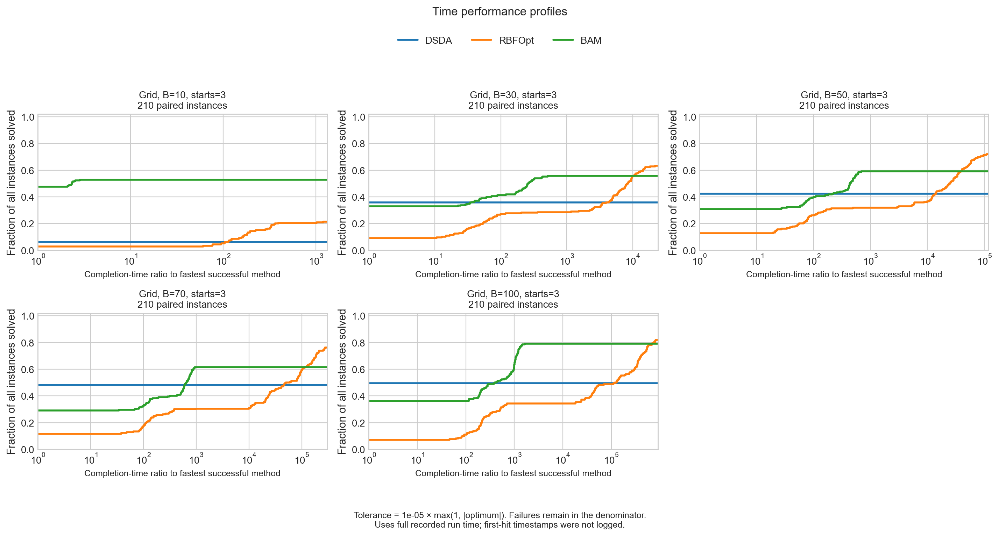
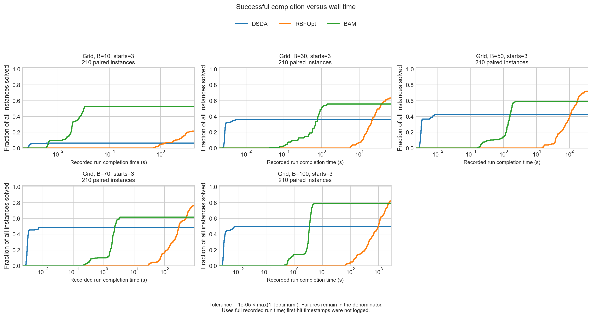
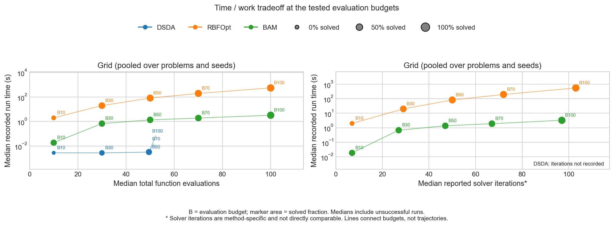

# Dantzig grid benchmark: time and work comparisons

These figures answer the time-profile and time/iteration follow-up on
[PR #23](https://github.com/SECQUOIA/RBFopt_Test/pull/23#issuecomment-5688291659).
They use all 3,150 recorded runs: 21 grids, 10 seeds, five evaluation budgets
(10, 30, 50, 70, 100), and DSDA, RBFOpt, and BAM. The shared three-point LHC
initialization counts toward the evaluation budget.

## Figures







## Reading the profiles

A run succeeds when its terminal objective satisfies
`abs(best_value - optimum) <= 1e-5 * max(1, abs(optimum))`.
This is the tolerance used by the existing grid performance profiles, not the
stricter exact-optimum hit flag. For example, RBFOpt at budget 10 has a 21.4%
tolerance-based solved fraction, compared with the previously reported 19.0%
exact-optimum hit rate.

For each grid/seed/initialization/budget instance, define `t` as the recorded
**full run wall time** if successful, and infinity otherwise. The time
performance ratio is `t / min_method(t)`. All-failed instances have infinite
ratios for every method. Each curve shows the fraction of all 210 instances
whose ratio is at most the horizontal-axis value. A ratio of one identifies
the fastest successful method; the plateau shows the fraction solved. Budgets
are kept in separate panels. Ratios start at one and fractions at zero.

The second figure uses seconds directly: the fraction of all instances with a
successful run completed by that time. It uses the same success rule and
denominator. Unsuccessful runs never enter either curve, but remain in its
denominator, including instances unsolved by every method.

The archive does **not** contain elapsed timestamps for incumbent improvements.
These are therefore completed-run profiles, not measured time-to-first-target
curves. Total run time is not prorated by evaluations, and no per-evaluation
times are inferred. The original solver runs may continue after finding the
target. Exact first-hit-time profiles would require new runs logging elapsed
wall time, including optimizer overhead, at each objective evaluation.

## Reading the tradeoff

Each point summarizes 210 runs at one method/budget; failed runs are included
in the medians. The left panel compares median total function evaluations with
median full run wall time. The right panel shows reported solver iterations,
whose definitions differ between methods and are not directly comparable.
DSDA's grid iteration counts were not recorded and are explicitly marked as
missing. Marker area represents the tolerance-based solved fraction. Labels
give the evaluation budget; connecting lines are across budgets, not within-run
trajectories. Marginal medians are descriptive summaries, not individual runs
or a fitted Pareto frontier.

At budget 100, median recorded time is approximately 0.00324 s for DSDA,
3.26 s for BAM, and 549.90 s for RBFOpt. Their solved fractions are 49.5%,
79.0%, and 81.9%, respectively. This exposes the substantial overhead associated
with RBFOpt's higher observed solved fraction. Objectives are precomputed
lookups, so these timings do not include repeatedly solving expensive models.

## Reproduce and audit

From the repository root with the project dependencies installed:

```bash
MPLBACKEND=Agg python timing_analysis.py \
  --dataset grid \
  --archive results/archives/dantzig_20260910_170759_slN8tv.zip \
  --output-dir results/grid_benchmarks/dantzig_20260910/analysis
```

The command reads the original `benchmark.csv` directly from the existing ZIP;
no additional unpacked raw grid CSV is committed. Grid optima come from
`benchmark_grids/`. The output contains:

- [Per-run costs and ratios](analysis/time_profile_runs.csv), including infinite
  costs for failures and the full paired run identifiers.
- [Time/work summary](analysis/time_work_summary.csv), including success counts,
  runtime medians/quartiles, evaluation counts, and iteration-report coverage.
- [Analysis provenance](analysis/timing_analysis.manifest.json), recording the
  ZIP and CSV checksums, grid hashes, analysis source hashes, tolerance, and
  package versions.

The raw archive is unchanged. The plotting code rejects nonpositive or
nonfinite runtimes, duplicate runs, incomplete method pairings, and objectives
materially below the recorded optimum. Automated tests cover failure
denominators, exact step locations, budget separation, and ZIP regeneration.

The corresponding [process-case figures](../../case_studies/dantzig_20260910/README.md)
use the same time definitions, with separate profiles for all 14 configurations.
