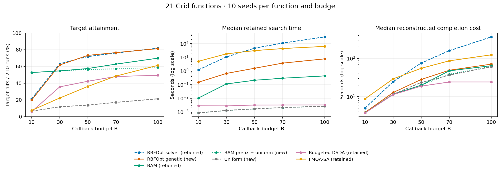
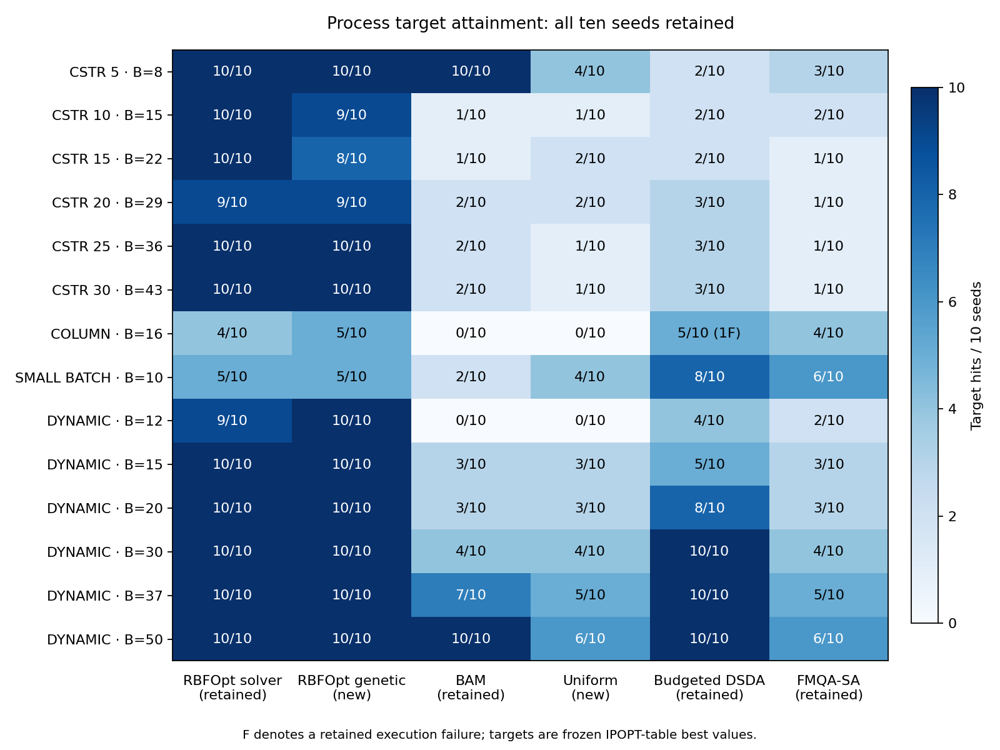

# Additional genetic-search and sampling comparisons

The October 20 Dantzig return contains all **3,430 planned runs**: 1,558 target
hits and 1,872 target misses, with no failed, interrupted or missing run slots.
This is an additional comparison; it does not replace historical solver-option
RBFOpt results or the corrected BAM Process selection.

The main finding is that genetic candidate search greatly reduces the observed
RBFOpt search overhead while producing almost the same aggregate target counts
on these retained inputs. This is not an equivalence test or a claim that the
two variants visit the same points. The low-budget BAM advantage also needs to
be interpreted alongside its fixed sampling prefix.

## Target counts

Each Grid column below pools 21 functions, five budgets and ten seeds (1,050
runs). Process pools 14 model–budget conditions and ten seeds (140 runs).
These descriptive totals weight each condition equally; they are not 1,050 or
140 independent replications of one problem. Use the per-condition tables for
inference, especially the six related Dynamic budgets.

| Method | Grid target hits / 1,050 | Process target hits / 140 | Source |
|---|---:|---:|---|
| RBFOpt MSRSM / solver | 661 | 127 | retained |
| RBFOpt MSRSM / genetic | 658 | 126 | new |
| BAM | 626 | 47 | retained; corrected Process BAM |
| BAM fixed prefix + uniform continuation | 589 | — | new Grid control |
| Uniform without replacement | 149 | 36 | new |
| Budgeted DSDA | 382 | 75 | retained |
| FMQA-SA | 370 | 42 | retained |

The retained Process DSDA Column seed failure remains a failure. The original
560-run Process comparison remains **291 hits, 268 misses and one failure**.
Together, 4,760 historical and 3,430 new runs give 8,190 comparison rows:
3,888 hits, 4,301 misses and the original one failure.

At each Grid budget the denominator is 210 runs:

| B | RBFOpt solver | RBFOpt genetic | BAM | BAM prefix + uniform | Uniform |
|---:|---:|---:|---:|---:|---:|
| 10 | 45 | 42 | 111 | 111 | 14 |
| 30 | 133 | 130 | 115 | 115 | 25 |
| 50 | 151 | 154 | 121 | 119 | 29 |
| 70 | 160 | 161 | 132 | 120 | 36 |
| 100 | 172 | 171 | 147 | 124 | 45 |

At B=10, all 210 BAM-prefix control runs have the same best objective and target
classification as their retained BAM counterpart: all ten callbacks are in the
shared initial/predetermined portion. The control still attains 124/210 targets
at B=100, versus BAM's 147/210. Thus the fixed design explains the entire B=10
result and much of the low-budget performance, while BAM's later adaptive
search adds value at higher budgets. This is an empirical control, not a full
causal decomposition of proprietary BAM internals. At B=30, equal total hits
alone do not establish identical per-seed outcomes.

The grouped descriptive bootstrap interval for genetic minus solver success
includes zero at every Grid budget. At B=100 it is -0.48 percentage points with
a 95% percentile interval of [-6.19, 5.71]. BAM-prefix minus BAM at B=100 is
-10.95 points, interval [-23.81, -0.48]. These are exploratory, unadjusted
intervals from resampling intact functions with their ten paired seeds; no
equivalence or multiple-comparison claim is made.

Process genetic differences are localized: CSTR10 10→9 hits, CSTR15 10→8,
Column 4→5, and Dynamic B12 9→10. All other condition hit counts agree,
including CSTR30 10/10 and Small Batch 5/10. Identical totals do not imply
identical successful seeds: across Process there are four genetic-only hits
and five solver-only hits; Grid has 68 genetic-only and 71 solver-only hits.

## Timing interpretation

| Scope | Solver median search, s | Genetic median search, s | Median paired solver/genetic search ratio | Median paired reconstructed cost ratio |
|---|---:|---:|---:|---:|
| Grid | 36.6820 | 1.9874 | 14.81 | 2.12 |
| Process | 5.6840 | 0.7718 | 6.58 | 1.18 |

The ratio columns are medians of matched case–budget–seed ratios, **not ratios
of the two displayed medians**. Genetic search is faster in 1,047/1,050 Grid
pairs and 138/140 Process pairs. Reconstructed total cost is lower in 983 and
132 pairs, respectively. Individual timings and ratios are available in
[rbfopt_paired_runs.csv](tables/rbfopt_paired_runs.csv).

Retained search is measured search-stage wall time minus actual CSV lookup
callback time. Reconstructed completion cost adds the saved point costs for
every callback and the one-time Dynamic preparation charge. It is not a new
online NLP timing. Extraction/export and worker startup are separate; the
worker-wall sum is 11,698.13 seconds, while recorded search-stage time sums to
5,490.86 seconds. Neither sum includes all controller idle and export time.
The return does not support exact end-to-end batch duration from these sums.
Old Grid DSDA lacks a separate lookup timer; its retained recorded time still
includes lookup and this limitation is preserved.

The recorded Python/package versions, Dantzig host and Bonmin/IPOPT binaries
match the historical references. New work used one thread on CPU 2; historical
Grid RBFOpt used CPU 0, and the Linux kernel release also differs. These are
observed retained-run comparisons, not simultaneous controlled microbenchmarks.
Only `global_search_method: solver → genetic` differs in all 1,190 recorded
RBFOpt settings comparisons. Other surrogate solves remain enabled.

The fixed-path alpha=.01,.1,1,10,100 tables are in the original ZIP and are
regenerated by the audit command. They rescale saved point costs without
changing trajectories or success counts. For example, Grid B100 median
solver/genetic completion costs are 307.42/8.15 seconds at alpha=.01,
365.74/70.81 at alpha=1, and 6,343.39/6,101.70 at alpha=100. Search overhead
matters much less as point cost dominates. These scenarios do not predict
new adaptive paths under changed time limits.

Removing Yang3 and then Bohachevsky2 leaves the main descriptive patterns:
at B=100 without both, solver/genetic are 80.00%/79.47%, BAM/prefix are
66.84%/54.74%, and uniform is 17.89%. At B=10, BAM and its prefix control
both retain 47.89%, versus solver/genetic 16.84%/15.79%.

## Verification and retained limitations

[verification.json](verification.json) records the independent return audit:

- Original ZIP SHA256 and CRC passed; 38,461 archive members retained unchanged.
- All 3,430 slots have one sealed attempt; 22,497 sealed files verified.
- All 170,660 callbacks meet their budgets, shared initial order, domain,
  accepted objective, penalty and point-cost rules. No short budgets, missing
  times or repeated callbacks occurred in this return. Repeat accounting is
  still covered by tests; repetitions are not silently deduplicated.
- 2,744 unaccepted callbacks retain their source statuses and reasons:
  1,370 `preprocessing_infeasible`, 1,342 `logical_infeasible`, 32 `rejected`.
  A rejected solver record is not reclassified as mathematical infeasibility.
- Both runs with no accepted initial point continued within budget. The final
  Process observation remains recorded even though its budget exception means
  it is not returned to the optimizer.
- There are **696 recorded Process surrogate Bonmin starts: 542 end events and
  154 error events**. Those errors remain in the original logs and are distinct
  from a failed DFO run. All affected DFO runs completed their budgets. Grid
  lacks that structured auxiliary-call ledger; no Grid solver-call count is
  inferred. No original Process NLP was rerun by this package or this audit.
- The six analysis CSVs plus progress and interpretation JSON replay
  byte-for-byte. Clock-sum verification permits 1e-12 arithmetic differences
  between Python versions; target and acceptance tolerances are unchanged.
- 29 relevant tests passed; Ruff and diff checks passed. Matplotlib emitted
  existing Pyparsing deprecation warnings. See [the test log](validation/tests.log).
- Server plotting was unavailable (`No module named 'matplotlib'`). The figures
  below were generated locally from verified tables and visually checked;
  their input/output hashes and Matplotlib version are recorded separately.

This completes the additional genetic/sampling experiments and their frozen analysis.
The separate [limited FMQA diagnostic](../review_diagnostics_20261020/README.md) verifies seven reconstructed fits; historical fitted weights remain unavailable.
The later [CSTR15 follow-up](../review_feasibility_tautology_20261020/summary.json), retained in commit `854a1a7fc5a20a5489d82ef7991a16aaf89025f3`, passed the `1e-8` numerical feasibility check on the original GDP with objective `2.8293940632857546` and maximum unscaled violation `3.3306690738754696e-16`.
The recorded A12 lower-bound discrepancy persists, with a difference of `0.6931579445174396`.
This is numerical evidence for the retained point, not a proof of exact mathematical feasibility, global optimality or a solver defect.
Earlier option errors and the no-solution `TOO_FEW_DOF` follow-up remain historical records; manuscript synchronization and public-release/access checks are outside this status correction.
The original manifests retain their historical hashes; [status_correction.json](status_correction.json) separately records the documentation-only updates and preserved evidence.
See [review disposition](../../docs/review_comparison_status.md).

## Files, provenance and reproduction

| Artifact | Location / source |
|---|---|
| Unmodified return ZIP, all callbacks, logs and runtime/config records | [archive](../archives/review_comparison_20261020_124949_return_1792527395393579314.zip), [supplied SHA256](../archives/review_comparison_20261020_124949_return_1792527395393579314.zip.sha256) |
| Original execution package | [runner ZIP](../runners/review_comparison_20261020.zip), provider revision `38d917ef75ef6767c2a9f238d88be19bf0b89160` |
| All frozen inputs, reference settings, starts, historical manifests | Return member `review_comparison_20261020_124949/reproduction/` |
| Controller and individual logs | Return members `controller_logs/` and `jobs/<job_id>/attempt_*/run.log` below the run root |
| Callback validation by run | [new_run_audit.csv](new_run_audit.csv) |
| All 8,190 comparison records | [completed_runs.csv](tables/completed_runs.csv) |
| Every ten-seed condition; counts, cost, empirical TTS99 | [condition_summary.csv](tables/condition_summary.csv) |
| Every new slot | [new_slots.csv](tables/new_slots.csv) |
| Paired success contrasts / Grid exclusions | [paired_success.csv](tables/paired_success.csv), [grid_exclusions.csv](tables/grid_exclusions.csv) |
| Pooled descriptive counts / Grid budget counts | [method_summary.csv](tables/method_summary.csv), [grid_budget_summary.csv](tables/grid_budget_summary.csv) |
| Grid and Process figures | [Grid PDF](figures/grid_comparison.pdf), [Process PDF](figures/process_target_counts.pdf), PNGs and [figure manifest](figures/manifest.json) |
| Exact published file hashes, archived input identities, source-file hashes | [manifest.json](manifest.json) |

Detailed files remain archived once, rather than adding 38,461 extracted files
to Git. The large fixed-path sensitivity CSV remains in the ZIP and is emitted
by replay. Existing execution revisions are never replaced by the publication
commit. Use `git rev-parse HEAD` to identify the checkout providing this report;
use the recorded provider/archive identities to identify the executed code.

From the repository root, with Python 3.10+ (the audit was run with 3.12.13):

```bash
# Inspect the supplied digest from its own directory.
(cd results/archives && shasum -a 256 -c review_comparison_20261020_124949_return_1792527395393579314.zip.sha256)

# New output directory; verifies and replays stored records only.
python -m review_comparison.audit --output /tmp/review-comparison-audit

# Optional local figures; requires Matplotlib. No solver is needed.
python -m review_comparison.plot_return \
  --tables /tmp/review-comparison-audit/tables \
  --output /tmp/review-comparison-figures

python -m pytest tests/test_review_comparison.py \
  tests/test_review_comparison_audit.py tests/test_final_process_artifacts.py -q
```

The audit refuses an existing output directory and never runs the worker,
optimizer, GDP builder or an NLP solver. Its analysis source is checked against
the executed source snapshot before replay. The execution commands remain in
[the Dantzig guide](../../docs/review_comparison_dantzig.md); they are separate
from the analysis-only commands above.




